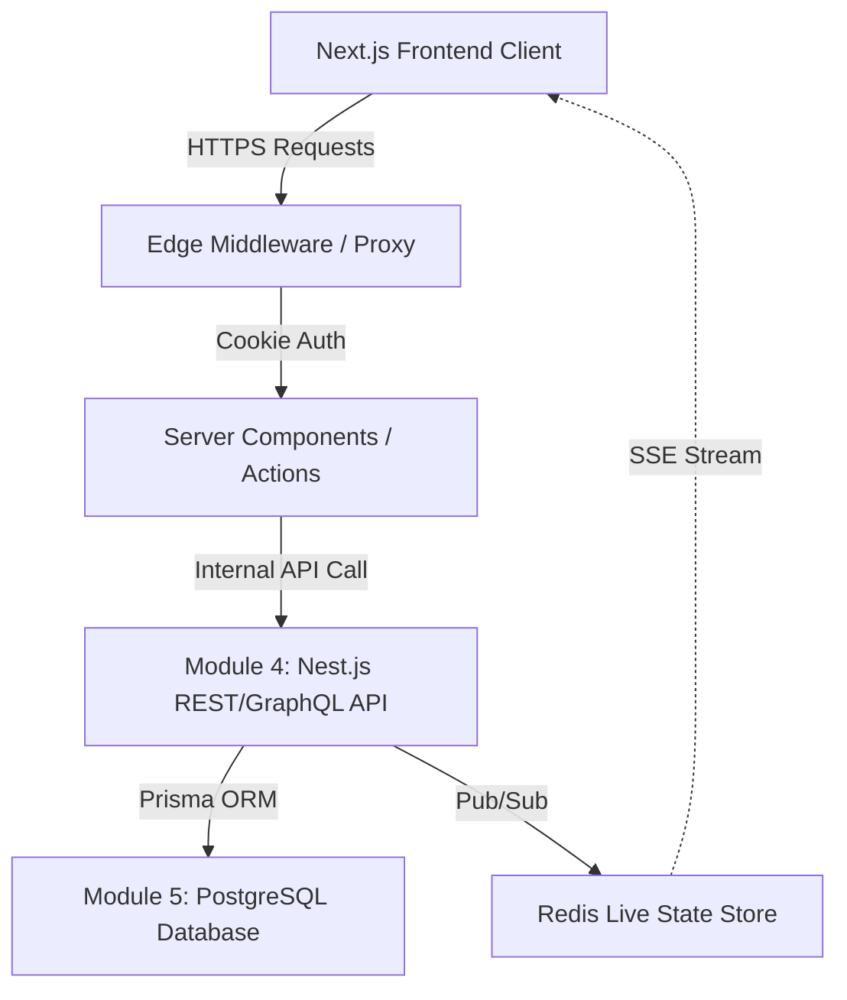

# Addis Eats · Post-Assessment Technical Roadmap (FUTURE.md)

> **Document Status:** Post-Assessment Working Document (Module 3 · Day 50)  
> **Rule:** Note everything here rather than modifying the verified production build on assessment day.  
> **Scope:** Technical debt, reviewer feedback, architectural evolution, and Module 4/5 integration prep.

---

## 1. High Priority Items (Post-Assessment Sprint)

| Item | Area | Rationale | Planned Action & Target Timeline |
| :--- | :--- | :--- | :--- |
| **Migrate Middleware convention** | Next.js Architecture | Next.js 16 warns: `The "middleware" file convention is deprecated. Please use "proxy" instead.` | Migrate `middleware.js` to the new Next.js route proxy standard once Module 4 begins (Week 11). |
| **Persistent PostgreSQL Database** | Data Persistence | Currently using in-memory mock store (`lib/data.js`). In-memory records reset on server restart/container redeploy. | Replace mock store with PostgreSQL + Prisma ORM in Module 5, preserving existing repository contracts. |
| **Real-time WebSockets / SSE** | Live Order Tracking | SWR 5-second polling creates periodic HTTP requests. A persistent SSE or WebSocket channel lowers overhead. | Implement Server-Sent Events (SSE) route `/api/orders/[id]/live` in Nest.js backend (Module 4). |
| **Leaflet SSR Dynamic Import Refactor** | Client Boundary | Map component requires `dynamic(() => import(...), { ssr: false })` to avoid `window is not defined`. | Extract map view into a standalone micro-package or pre-rendered static vector canvas with lazy hydration. |
| **Session Refresh & Revocation List** | Security | Current sessions rely on self-contained signed HMAC-SHA256 cookies without a revocation list. | Add Redis-backed session blacklist to allow instantaneous logout across multiple devices. |

---

## 2. Peer Review Feedback Log (Day 50 Ingestion)

During the Day 50 peer code review session, the following observations and constructive questions were surfaced:

### Question 1: Handling Network Disconnections During Polling
- **Observation:** If the user goes offline while viewing `/orders/[id]`, SWR attempts retries with exponential backoff, but there is no prominent UI toast informing the user that live status is paused.
- **Action Item:** Add an `isOffline` visual badge to the `<OrderStatusBadge />` component when `navigator.onLine === false` or `swr.error` persists.

### Question 2: Idempotency Key Expiration
- **Observation:** `idempotencyOrderCache` in `app/actions.js` stores processed tokens in memory. Over long running server sessions, memory could leak if keys are never purged.
- **Action Item:** Wrap the cache in an LRU (Least Recently Used) cache or time-to-live (TTL) map with a 15-minute cleanup interval.

### Question 3: Form Accessibility & Live Announcements
- **Observation:** Form validation errors are rendered visually under inputs, but screen readers may not immediately announce errors if `aria-live="polite"` is not attached to the error container.
- **Action Item:** Wrap field-level error messages in `
` in both `LoginForm.jsx` and `OrderForm.jsx`.

---

## 3. Performance & Asset Optimizations (Next Horizon)

1. **Self-Hosted Variable Fonts:**
   - Currently using `next/font/google` for Inter and Playfair Display.
   - *Future enhancement:* Bundle the WOFF2 files locally in `public/fonts/` to ensure zero third-party DNS lookups, guaranteeing offline development resiliency.
2. **AVIF Format Conversion:**
   - Pre-convert local menu images to `.avif` alongside `.webp` in the build pipeline for an additional 15-20% byte reduction.
3. **Optimistic UI Updates for Kitchen Dashboard:**
   - When kitchen staff updates order status from "Received" to "Preparing", apply React 19 `useOptimistic` to immediately reflect the state change before server revalidation completes.

---

## 4. Module 4 & 5 Architecture Bridge

- **Module 4 (Day 51+):** Decouple `lib/data.js` into an external RESTful service built with Node.js & Nest.js.
- **Module 5:** Design normalized schemas for `Dishes`, `Categories`, `Users`, `Orders`, and `OrderItems` with foreign key constraints and transactional integrity.
